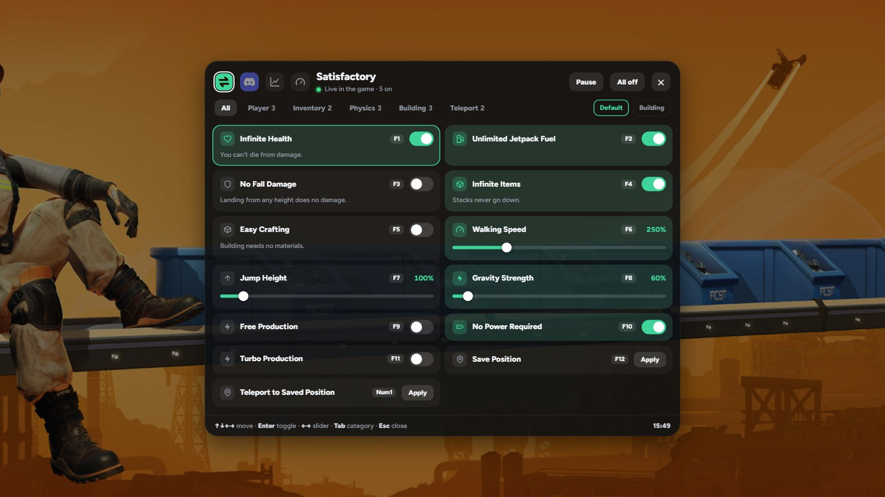
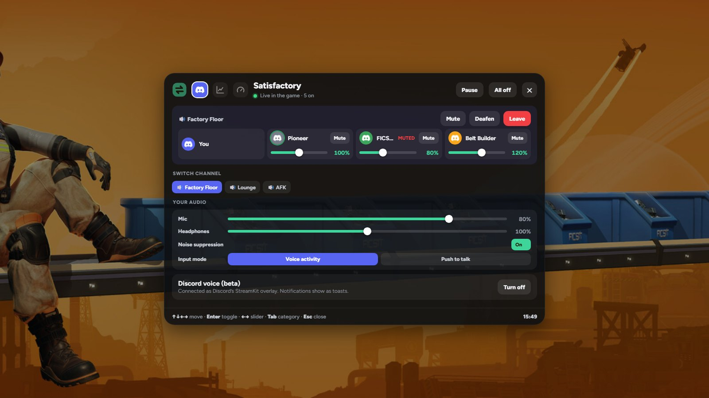
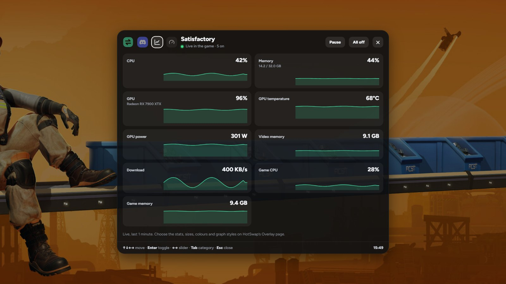
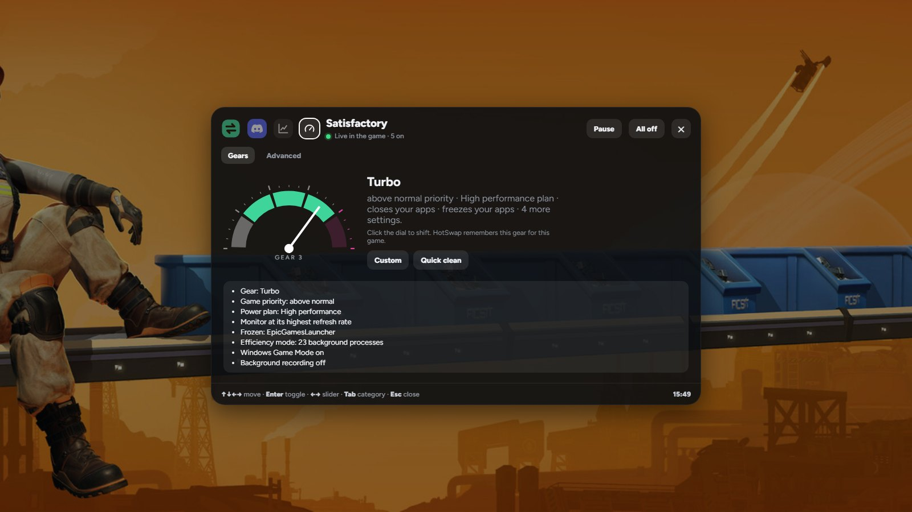
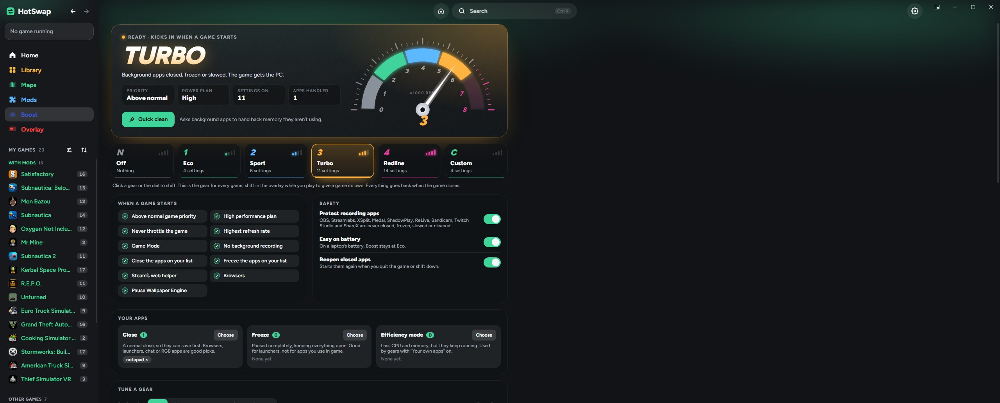
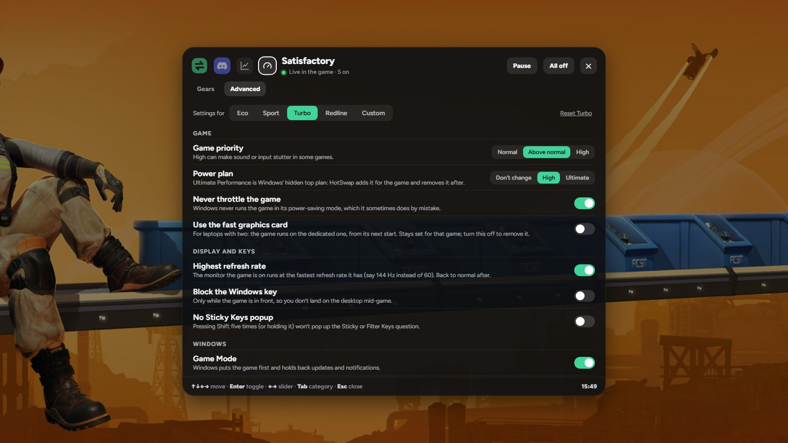
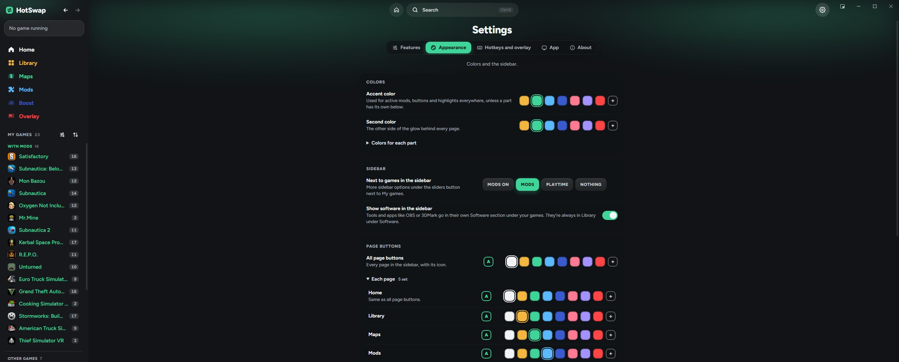

# ✨ HotSwap features

Everything HotSwap can do, in detail. For the short version, see the [README](README.md).

- [🎮 Games](#-games)
- [🧰 Engine mods](#-engine-mods)
- [🎛️ In-game overlay](#️-in-game-overlay)
- [🏎️ Boost](#️-boost)
- [🎨 Make it yours](#-make-it-yours)
- [💬 Discord](#-discord)
- [🗺️ Live maps](#️-live-maps)
- [🧩 Mod loader](#-mod-loader)
- [📚 The app](#-the-app)
- [⚙️ How the mods work](#️-how-the-mods-work)

## 🎮 Games

Mods work live while you play: HotSwap connects to the running game, and the side panel shows **Connected. Mods are live in the game.** Everything happens in the game's memory only, so nothing is written to your save: restart the game and it's all back to normal. Still, **keep a backup save** while experimenting.

Games marked **experimental** are new and haven't been tested in the game yet. Tried one? Tell us with **Report a bug** in Settings.

### 🏭 Satisfactory

| | Mod | What it does |
|---|---|---|
| 🧍 | **Infinite Health** | You can't die from damage (falling off the map still kills you) |
| 🧍 | **Unlimited Jetpack Fuel** | The jetpack never runs dry |
| 🧍 | **No Fall Damage** | Land from any height |
| 🎒 | **Infinite Items** | Inventory stacks never go down, used-up items come back |
| 🎒 | **Easy Crafting** | Building and workbench crafting need no materials |
| 🏃 | **Walking Speed / Jump Height / Gravity** | Sliders from 10% to 1000% (gravity down to 0 = float) |
| 🏃 | **Game Speed / Super Speed** | Speed up or slow down the whole game |
| 🏗️ | **Free Production** | Machines get their ingredients delivered automatically (outputs still need belts) |
| 🏗️ | **Turbo Production** | Every machine runs at 500% clock speed |
| 🏗️ | **No Power Required / No Fuel Needed** | Factories and generators run for free |
| 📍 | **Save Position / Teleport** | Remember where you stand and jump back, even after a restart |

### 🌊 Subnautica 2

| Mod | What it does |
|---|---|
| **Infinite Health / Oxygen** | Never run out |
| **No Hunger / No Thirst** | Food and water stay full |
| **No Temperature Damage** | Heat and cold do no damage |
| **Free Dash** | Dashing costs no oxygen |
| **Swim Speed / Walk Speed** | 10% to 500% |
| **Free Crafting / Instant Crafting** | No materials, no waiting (building too) |
| **Infinite Energy** | Tools, vehicles and batteries never run out |

Subnautica 2 ships without debug symbols, so HotSwap finds the engine's object and name tables by their layout in memory.

### 🐠 Subnautica

Infinite Health, Infinite Oxygen, No Hunger, No Thirst, Swim Speed, Walk Speed, Free Crafting, Unlock All Blueprints, Instant Building, Instant Scanning, Fast Growing, Infinite Energy, No Crush Depth and Passive Creatures. Most of them switch the game's own console cheats.

### ❄️ Subnautica: Below Zero

Infinite Health, Infinite Oxygen, No Hunger, No Thirst, No Freezing, Swim Speed, Walk Speed, Free Crafting, Unlock All Blueprints, Fast Growing, Infinite Energy, No Crush Depth and Passive Creatures. Most of them switch the game's own custom game mode options and console cheats.

### 👻 R.E.P.O.

Infinite Health (the game's own god mode), Infinite Stamina, Infinite Jumps, Movement Speed, Grab Strength, Throw Strength, Infinite Battery, Valuables Never Break, Complete Extractions, Add $10,000, and an **Enemy Radar** in the corner of your screen. For single-player and private lobbies with friends who know you're using it.

### 🚀 Kerbal Space Program

Unlimited Fuel, Unlimited Monopropellant, Unlimited Flight Resources, Invincible Craft, No Overheating, Unlimited Funds, Unlimited Research Points, Max Reputation, Any Contract, Add Funds / Science / Reputation, Part Clipping, Free Attachment, Unlimited Inventory, Gravity and Show Biomes. Most of them flip KSP's own Alt+F12 cheats; the refills work on the vessel you're flying.

### 🧪 Oxygen Not Included

Instant Build, Sandbox Tools, Printing Pod Always Ready, Max Game Speed, No Stress, No Hunger, Infinite Breath, No Fatigue, No Bladder, Full Health, Instant Research and Finish Research Queue. Instant Build and Sandbox Tools switch the game's own debug and sandbox modes.

### 🚗 Mon Bazou

No Hunger, No Thirst, No Sleep, No Anxiety, Unlimited Money, Add $10,000, Walk Speed, Jump Height, Infinite Fuel, No Derby Damage, Freeze Time and Always Day.

### 🚚 Euro Truck Simulator 2 and American Truck Simulator (experimental)

No Damage, Infinite Fuel, No Fatigue, Repair Truck and Trailer, Refuel, Infinite Money, Add €100,000 (or $), Add 10,000 XP and Level Up, live while you drive. No hard-coded offsets: HotSwap reads the game's own save-file metadata from the exe you have, so updates are followed automatically.

### 🚁 Stormworks (experimental)

Infinite Money, Add $100,000, Add 100 Research Points, Infinite Fuel, Infinite Batteries, Infinite Ammo, No Vehicle Damage, No Engine Overheating, No Player Damage, No Clip, Map Teleport, Unlock All Components, Unlock All Islands, Clear Fog of War, Clear Weather, No Sharks and No Megalodon. They work through the game's own addon system (no memory editing): HotSwap adds a HotSwap addon, which you turn on when you create a world.

### 🧟 Unturned (experimental, singleplayer only)

Infinite Health, No Hunger, No Thirst, Infinite Stamina, No Infection, Infinite Oxygen, Infinite Ammo, No Weapon Decay and Add 1,000 Experience. Unturned's servers use VAC and BattlEye, so the mods only run in singleplayer: HotSwap checks twice a second that the game is its own server with no anti-cheat active, turns everything off the moment you join a server, and stops touching the game until it restarts if an anti-cheat loads.

### 🚓 GTA V story mode (experimental, Legacy and Enhanced)

God Mode, Never Wanted, Fast Run, Fast Swim, Super Jump, Heal and Armor, Infinite Ammo, Vehicle God Mode, Repair Vehicle, Spawn Sports Car, Spawn Helicopter, Add $1,000,000, Teleport to Waypoint, time and weather. They use the game's own script commands through [Script Hook V](https://www.dev-c.com/gtav/scripthookv/) (install it once; the game page has a short setup guide with the link) and HotSwap's own plugin. Story mode only: BattlEye has to be off (`-nobattleye`), which keeps the game out of GTA Online, and the plugin does nothing in an online session.

### ⛏️ Mr.Mine (experimental)

Infinite Money and Double Money, live. Start Mr.Mine with HotSwap's **Play** button: HotSwap opens the game's debugging port and changes the game's own JavaScript variables.

### Everything else

Every other game shows up in your library with art, playtime and launching. Its mod list is empty, marked **Soon**, or filled with [engine mods](#-engine-mods). Want mods for a game? Use **Request mods** on its page.

## 🧰 Engine mods

Single-player games without their own mod list still get mods if HotSwap knows their engine. The mods use the engine's own names for things, so they keep working after game updates:

| Engine | Mods |
|---|---|
| **Unity** (Mono and IL2CPP) | Game Speed, Unlock FPS (no frame cap, no VSync), Field of View |
| **Unreal Engine** 4.25 to 5.x | Game Speed, Field of View |
| **Godot** 3 and 4 | Game Speed |
| **RPG Maker MV and MZ** | Infinite HP, Infinite MP, Level Up Party, Infinite Gold, Add 10,000 Gold, Defeat All Enemies, No Random Encounters, Walk Through Walls, Move Speed, Save Anywhere |
| **Ren'Py** | Developer Console, Skip Unseen Text, Rollback Anywhere |

- RPG Maker games (and other web-tech games) need HotSwap's **Play** button, which starts them with a debugging port open.
- For Ren'Py and Godot, HotSwap adds a small script to the game, so the game needs one restart.
- Engine mods are marked experimental: they work on the engine, but each game can do things its own way.

## 🎛️ In-game overlay

The overlay is its own see-through window on top of your game: nothing is injected into the game, so it can't trip anti-cheat and works with every game, multiplayer ones included. Run games in **borderless or windowed** mode; exclusive fullscreen draws over it.

### The menu (Insert)

Press **Insert** (or your own key) in a game for a full menu over it. The tabs along the top:

- 🎮 **Mods:** every mod as a card with its icon, by category, with profiles, **Pause** and **All off**. Use the mouse or the arrow keys, Tab for categories.

- 💬 **Discord:** your voice call, if Discord voice is on: who's in it and who's talking, mute, deafen, leave, per-person volume, your mic and headphone volume, noise suppression, and switching voice channels.

- 📊 **System:** live graphs of your PC while you play. Pick what to see on HotSwap's Overlay page:
  - **CPU:** usage, temperature, power
  - **Memory:** RAM, and video memory
  - **GPU:** usage, temperature, hotspot, power, clock, fan
  - **Disk:** read and write; **network:** download and upload
  - **The game itself:** its CPU, memory and GPU use
  - Each as a line, area or bar graph, number only, in small, medium or large cards, over the time window you pick
- 🏎️ **Boost:** the rev-counter dial to shift gears live, Quick clean, what Boost is doing right now, and the **Advanced** tab to change any gear's settings without leaving the game.

### Also on screen

- **HUD:** a small corner panel with your active mods, session time, CPU, RAM and the clock, and who's talking on Discord
- **Toasts:** a note with the mod's icon whenever a mod turns on or off, in the corner you pick
- **Cheat sheet:** hold **Ctrl+F1** to see every mod's hotkey
- **Enemy Radar** (R.E.P.O.): its own little window in a corner
- **Frame generation friendly mode**, for games using DLSS or FSR frame generation
- With **Low memory mode** on, the overlay closes 20 seconds after you last used it, freeing its memory

## 🏎️ Boost

A gearbox for your PC while you play: shift between **Eco, Sport, Turbo, Redline** and your own **Custom** gear on a rev-counter dial, on the **Boost** page in the sidebar or in the overlay. Changes apply live, and everything goes back when the game closes. If HotSwap ever closes mid-game, its next start puts things back.

Boost works with **every game**, multiplayer and anti-cheat games included: it only changes Windows settings and the game's priority, the way Task Manager does, and never reads or writes the game's memory.

The Boost page shows everything in one place: the gear and what it changes (priority, power plan, how many settings and apps), the dial, a card for every gear, what Boost is doing right now while a game runs, Quick clean with how much it last freed, the safety switches, your app lists and every gear's settings.

### Gears

Every gear is a set of real changes, and every gear is yours to change: in **Tune a gear** on the Boost page (or **Advanced** in the overlay), pick a gear with the 5-way switch and turn each setting on or off for it.

The starting points:

| Gear | What it does out of the box |
|---|---|
| **Eco** | Above normal game priority, highest refresh rate, never throttled, Wallpaper Engine paused |
| **Sport** | Eco + High performance power plan + Windows Game Mode |
| **Turbo** | Sport + no background recording + closes and freezes your apps + Efficiency mode for Steam and browsers |
| **Redline** | Turbo + Ultimate Performance plan + your own apps in Efficiency mode + no transparency + no Xbox Game Bar |
| **Custom** | Your own mix, starting like Sport |

### Every setting

| | Setting | What it does |
|---|---|---|
| 🎮 | **Game priority** | Normal, above normal or high. High can make sound or input stutter in some games |
| 🎮 | **Power plan** | Don't change, High performance, or Windows' hidden **Ultimate Performance** plan (added for the game, removed after) |
| 🎮 | **Never throttle the game** | Windows never runs the game in its power-saving mode, which it sometimes does by mistake |
| 🎮 | **Use the fast graphics card** | Laptops with two: the game runs on the dedicated one, from its next start |
| 🖥️ | **Highest refresh rate** | Only the monitor the game is on, at the fastest refresh rate it has at your resolution |
| ⌨️ | **Block the Windows key** | Only while the game is in front |
| ⌨️ | **No Sticky Keys popup** | Shift five times (or held) won't pop up Sticky or Filter Keys |
| 🪟 | **Game Mode** | Windows puts the game first and holds back updates and notifications |
| 🪟 | **No background recording** | Xbox Game Bar stops recording the last minutes of play |
| 🪟 | **No mouse acceleration** | "Enhance pointer precision" off, so aim follows your hand exactly |
| 🪟 | **No transparency effects** | Plain backgrounds instead of see-through ones |
| 🪟 | **No Xbox Game Bar** | The controller's Xbox button and Win+G don't open it while the game is in front |
| 📦 | **Close your apps** | The apps on your close list get a normal close (they can save first), and reopen after if you like |
| 📦 | **Freeze your apps** | The apps on your freeze list are paused completely, keeping everything open, and resumed after |
| 🍃 | **Efficiency mode** | Like Task Manager's leaf, for Steam's web helper, browsers, Discord or apps you pick: less CPU, and their memory goes first when the game needs more |
| 🖼️ | **Pause Wallpaper Engine** | Your animated wallpaper stops while you play |
| 🫥 | **Tuck HotSwap away** | HotSwap's window goes to the tray and frees its memory; mods, hotkeys and the overlay keep working |

### And

- **A gear per game:** shift in the overlay while a game runs and HotSwap remembers that gear for it
- **Easy on battery:** laptops stay at Eco on battery, and shift back up when plugged in
- **What it's doing:** a live list under the dial, e.g. "Power plan: High performance · Frozen: EpicGamesLauncher"
- **Quick clean:** a one-off button that asks background apps to hand back memory they aren't using, and says how much was freed
- **Recording apps protected:** OBS, Streamlabs, XSplit, Medal, NVIDIA ShadowPlay, AMD ReLive, Bandicam, Twitch Studio and ShareX are never closed, frozen, slowed or cleaned, and high game priority stays at above normal while one runs. Can be turned off.

No fake "RAM cleaning": Windows already gives games free memory instantly, and emptying it makes games load slower. Boost only changes Windows settings and the game's priority, using the same standard Windows calls as Task Manager. It never touches the game's memory.

## 🎨 Make it yours

### Modes

Settings → **Features** starts with three modes, for a lighter HotSwap when you only want part of it:

| Mode | What's left |
|---|---|
| **Everything** | All of HotSwap |
| **Boost only** | Home and Boost. No library, mods, maps, overlay, Discord or stats |
| **Overlay only** | Home and the in-game overlay with Discord, stats and Boost |

Or switch single parts on and off: Library, games and mods, Boost, the Home feed, Maps, the Mods page, Discord, system stats, the overlay, sounds and update checks. Switched off parts don't load or run at all.

### Colors

Settings → **Appearance**:

- 🎨 **Accent color** and a **second color** for the glow behind every page: 8 presets or any color you pick
- 🧩 **Colors for each part:** the sidebar, Home, Library, game pages, Maps, Mods, Boost, Overlay (the in-game one too) and Settings can each have their own accent
- 🔤 **Page buttons:** one color for all of them, or a different one for each page
- ✏️ **Text colors** for game names, section labels, page titles and all other text. **A** follows the accent color of wherever the text is

### Settings

Settings is split into tabs: **Features, Appearance, Hotkeys and overlay, App** and **About**, and opens on the last one you used.

## 💬 Discord

- 🟢 **Status on your profile:** "Playing HotSwap" with the game and how many mods are on (turn it off in Settings)
- 🔊 **Discord voice (beta, opt-in):** everything in the overlay's Discord tab, plus who's talking on the HUD and Discord notifications as overlay toasts

Discord only gives voice access to apps it has approved, so Discord voice connects as **Discord's own StreamKit overlay**, the same way open-source overlays like [Discover](https://github.com/trigg/Discover) do. Discord asks you once to authorize "StreamKit", and the token stays on your PC. It's unofficial and may stop working if Discord changes it; everything else keeps working.

## 🗺️ Live maps

**Maps → Satisfactory** opens a map drawn from your running game:

- 🏔️ **Real terrain**, read from the game's own map texture in your install (never bundled)
- ⛏️ **Every resource node** by type and purity, plus wells, geysers and deposits
- 💎 **Collectibles:** power slugs, somersloops, mercer spheres and unopened crash sites
- 🏭 **Your factory:** buildings, belts, pipes, rails and power lines
- 📍 **Live position and trail**, pins, and **right-click teleport**
- 🌐 A **Detailed map** tab with Satisfactory Calculator's interactive map

**Subnautica** gets a map rendered from the game's own terrain files: a satellite-style view of the seabed (or a depth map), your live position and heading, and pins.

## 🧩 Mod loader

Browse, install, switch off and remove community mods from inside HotSwap:

- 🏭 **Satisfactory:** ficsit.app, with dependencies and the mod loader
- 👻 **R.E.P.O.**, 🐠 **Subnautica** and ❄️ **Below Zero:** one-click installs from Thunderstore, with BepInEx and dependencies set up automatically, or switch to Nexus Mods
- 🚗 **Mon Bazou:** Nexus Mods, with BepInEx set up automatically
- 🚀 **Kerbal Space Program:** one-click installs from SpaceDock into GameData
- 🌊 **Subnautica 2:** Nexus Mods (download on Nexus, HotSwap installs the file)

## 📚 The app

- 🎮 **Your real library:** finds installed Steam, Epic and GOG games, with artwork read from Steam's local cache, and the engine each game is made with
- 🧰 **Games vs software:** tools like OBS or 3DMark are sorted out using Steam's own app labels
- 🛡️ **Anti-cheat aware:** games with VAC, Easy Anti-Cheat, BattlEye or EA Javelin get no mods
- ▶️ **Real Play button:** launches through the game's store and detects when it's running, however you started it
- ⌨️ **In-game hotkeys:** rebindable, with clash warnings, plus a panic key that turns every mod off
- ⏻ **Power and stop:** pause all mods or close the game from the sidebar
- 🗂️ **Profiles:** save mod setups per game and switch in one click, or share one with a friend as a code
- 📌 **Pinned mods:** keep your favorites at the top, with a live dot when they're working in game
- 🎨 **Make it yours:** reorder, rename and hide mods and categories per game; reorder and pin the sidebar; switch off features you don't use; six accent colours
- 🪟 **Mini mode:** a small always-on-top window with just the running game's mods
- 📰 **Live Home:** developer news for your games, Steam deals (via CheapShark), top sellers, new releases, and your own sources
- ⏱️ **Playtime and sessions:** Steam hours plus time played with HotSwap
- 🔍 **Ctrl+K palette:** jump to any game, page, mod or action
- 📊 **Stats widget:** your PC's stats on the Home page and in the overlay
- 📦 **Mod lists between releases:** new games and fixes arrive from the repo's signed `catalog/mods.json`, checked against HotSwap's update key, without an app update
- 🔄 **Auto-updates:** signed updates from GitHub releases, installed with one click
- 🧾 **Logs:** Settings → Export logs packs everything needed for a bug report
- 🪶 **Low memory mode, tray icon, start with Windows**

## ⚙️ How the mods work

HotSwap is a trainer, like a friendlier Cheat Engine:

1. 🔎 **Finds the engine's tables by name.** Unreal Engine games like Satisfactory ship debug symbol files. HotSwap reads them to find the list of every live object and every name in the game.
2. 🧭 **Looks values up by name, not by hardcoded offsets.** For example "the player's `CharacterMovement` → `MaxWalkSpeed`". That's why it keeps working after game updates.
3. ✍️ **Writes the values you pick**, twice a second, so they stick through respawns.
4. 💉 **Calls game functions when needed.** For things like adding items, it runs the game's own `AddStack` through Unreal's `ProcessEvent`, so the game reacts properly.

For other engines, HotSwap asks the engine the same way: Unity's Mono and IL2CPP runtimes for classes, fields and properties by name, Chromium's DevTools protocol for Electron, NW.js and RPG Maker games, and a small script inside Ren'Py and Godot games. A new game's mods are then just a few lines of data (see `spec` in `ui/data.js`, and [CONTRIBUTING.md](CONTRIBUTING.md)).
