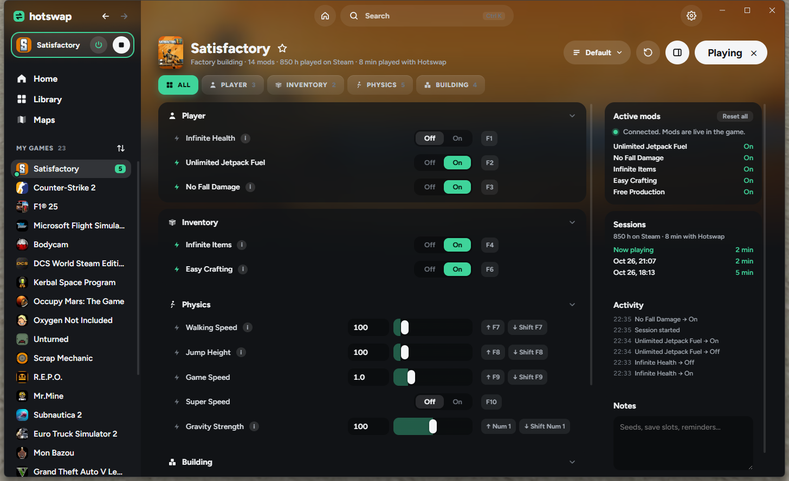
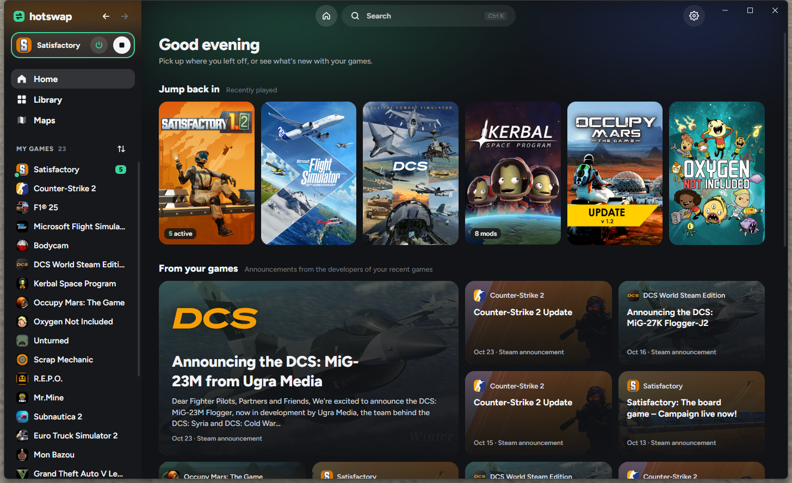
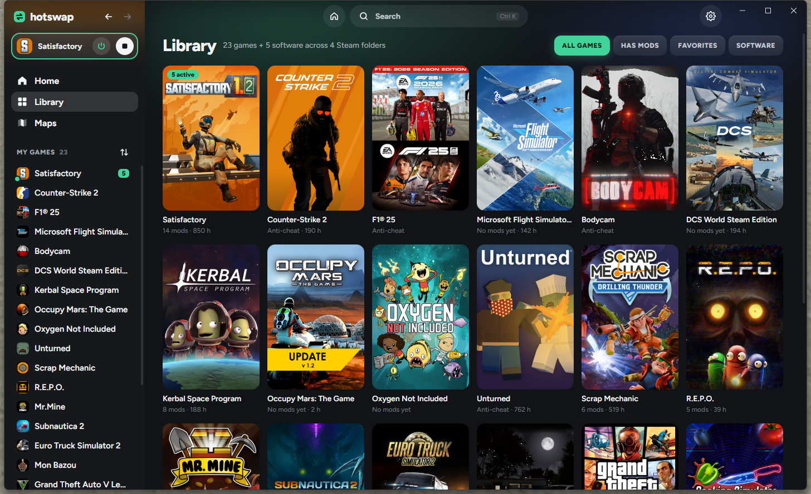

# 🔁 HotSwap

**Swap the way you play, in real time.**

HotSwap is a free, open-source, ad-free mod app for **single-player** PC games on Windows. Flip mods on and off while the game is running, from the app or with hotkeys that work inside the game.

> 💡 **Inspired by ArtCraft.**
> 🤖 **Made by AI.** HotSwap was designed and written by Claude (Anthropic's AI) in Claude Code, directed by [@Zetenypapp](https://github.com/Zetenypapp).

> 🎮 **Game support right now: Satisfactory, Subnautica, Subnautica 2, R.E.P.O., Kerbal Space Program, Subnautica: Below Zero, Oxygen Not Included and Mon Bazou.** These are the games with working mod settings so far. Every other game shows up in your library with art, playtime and launching, but its mod list is either empty or marked **Soon**.



## 🏭 Satisfactory mods

All of these work live while you play. HotSwap connects to the running game, and the side panel shows **Connected. Mods are live in the game.**

| | Mod | What it does |
|---|---|---|
| 🧍 | **Infinite Health** | You can't die from damage (falling off the map still kills you) |
| 🧍 | **Unlimited Jetpack Fuel** | The jetpack never runs dry |
| 🧍 | **No Fall Damage** | Land from any height |
| 🎒 | **Infinite Items** | Inventory stacks never go down, used-up items come back |
| 🎒 | **Easy Crafting** | Building and workbench crafting need no materials |
| 🏃 | **Walking Speed / Jump Height / Gravity** | Sliders from 10% to 1000% (gravity down to 0 = float) |
| 🏃 | **Game Speed / Super Speed** | Speed up or slow down the whole game |
| 🏗️ | **Free Production** | Machines get their ingredients delivered automatically (outputs still need belts) |
| 🏗️ | **Turbo Production** | Every machine runs at 500% clock speed |
| 🏗️ | **No Power Required / No Fuel Needed** | Factories and generators run for free |

Everything happens in the game's memory only. Nothing is written to your save file: restart the game and it's all back to normal. Still, **keep a backup save** while experimenting.

## 🚀 Kerbal Space Program mods

Unlimited Fuel, Unlimited Monopropellant, Unlimited Flight Resources, Invincible Craft, No Overheating, Unlimited Funds, Unlimited Research Points, Max Reputation, Any Contract, Add Funds / Science / Reputation, Part Clipping, Free Attachment, Unlimited Inventory, Gravity and Show Biomes. Most of them flip KSP's own Alt+F12 cheats; the refills work on the vessel you're flying.

## 👻 R.E.P.O. mods

Infinite Health (the game's own god mode), Infinite Stamina, Infinite Jumps, Movement Speed, Grab Strength, Throw Strength, Infinite Battery, Complete Extractions, and an **Enemy Radar** over your screen (experimental). For single-player and private lobbies with friends who know you're using it.

## 🐠 Subnautica mods

Infinite Health, Infinite Oxygen, No Hunger, No Thirst, Swim Speed, Walk Speed, Free Crafting, Unlock All Blueprints, Instant Building, Instant Scanning, Fast Growing, Infinite Energy, No Crush Depth and Passive Creatures. Most of them switch the game's own console cheats. Subnautica runs on Unity, and HotSwap looks up its classes and fields by asking the game's Mono runtime.

## ❄️ Subnautica: Below Zero mods

Infinite Health, Infinite Oxygen, No Hunger, No Thirst, No Freezing, Swim Speed, Walk Speed, Free Crafting, Unlock All Blueprints, Fast Growing, Infinite Energy, No Crush Depth and Passive Creatures. Most of them switch the game's own custom game mode options and console cheats.

## 🧪 Oxygen Not Included mods

Instant Build, Sandbox Tools, Printing Pod Always Ready, Max Game Speed, No Stress, No Hunger, Infinite Breath, No Fatigue, No Bladder, Full Health, Instant Research and Finish Research Queue. Instant Build and Sandbox Tools switch the game's own debug and sandbox modes.

## 🚗 Mon Bazou mods

No Hunger, No Thirst, No Sleep, No Anxiety, Unlimited Money, Add $10,000, Walk Speed, Jump Height, Infinite Fuel, No Derby Damage, Freeze Time and Always Day.

## 🚁 Stormworks mods (experimental)

Infinite Money, Add $100,000, Add 100 Research Points, Infinite Fuel, Infinite Batteries, Infinite Ammo, No Vehicle Damage, No Engine Overheating, No Player Damage, No Clip, Map Teleport, Unlock All Components, Unlock All Islands, Clear Fog of War, Clear Weather, No Sharks and No Megalodon. They work through the game's own addon system (no memory editing): HotSwap adds a HotSwap addon, which you turn on when you create a world. Not tested in game yet.

## 🌊 Subnautica 2 mods

| Mod | What it does |
|---|---|
| **Infinite Health / Oxygen** | Never run out |
| **No Hunger / No Thirst** | Food and water stay full |
| **No Temperature Damage** | Heat and cold do no damage |
| **Free Dash** | Dashing costs no oxygen |
| **Swim Speed / Walk Speed** | 10% to 500% |
| **Free Crafting / Instant Crafting** | No materials, no waiting (building too) |
| **Infinite Energy** | Tools, vehicles and batteries never run out |

Subnautica 2 ships without debug symbols, so HotSwap finds the engine's object and name tables by their layout in memory.

## 🗺️ Live map

Maps → Satisfactory opens a map drawn from your running game:

- 🏔️ **Real terrain**, read from the game's own map texture in your install (never bundled)
- ⛏️ **Every resource node** by type and purity, plus wells, geysers and deposits
- 💎 **Collectibles:** power slugs, somersloops, mercer spheres and unopened crash sites
- 🏭 **Your factory:** buildings, belts, pipes, rails and power lines
- 📍 **Live position and trail**, pins, and **right-click teleport**
- 🌐 A **Detailed map** tab with Satisfactory Calculator's interactive map

**Subnautica** gets a map rendered from the game's own terrain files: a satellite-style view of the seabed (or a depth map), your live position and heading, and pins.

## 🎛️ In-game overlay

Press **Insert** in game for a full menu over the game: every mod as a card with its icon, categories, profiles, pause and all-off, usable with the mouse or arrow keys. An optional **HUD** keeps your active mods, session time, CPU, RAM and the clock in a corner.

The overlay is its own see-through window on top of the game, so nothing is injected and it can't trip anti-cheat. Run games in **borderless or windowed** mode; exclusive fullscreen draws over it.

## 💬 Discord

- 🟢 **Status on your profile:** "Playing HotSwap" with the game and how many mods are on (turn it off in Settings)
- 🔊 **Discord voice (beta, opt-in):** who's in your call, who's talking (also on the HUD), real mute, deafen and leave, per-person volume, mic and headphone volume, noise suppression, switching voice channels, and Discord notifications as overlay toasts

Discord only gives voice access to apps it has approved, so Discord voice connects as **Discord's own StreamKit overlay**, the same way open-source overlays like [Discover](https://github.com/trigg/Discover) do. Discord asks you once to authorize "StreamKit", and the token stays on your PC. It's unofficial and may stop working if Discord changes it; everything else keeps working.

## 🧩 Mod loader

Browse, install, switch off and remove community mods from inside HotSwap:

- 🏭 **Satisfactory:** ficsit.app, with dependencies and the mod loader
- 👻 **R.E.P.O.**, 🐠 **Subnautica** and ❄️ **Below Zero:** one-click installs from Thunderstore, with BepInEx and dependencies set up automatically, or switch to Nexus Mods
- 🚗 **Mon Bazou:** Nexus Mods, with BepInEx set up automatically
- 🚀 **Kerbal Space Program:** one-click installs from SpaceDock into GameData
- 🌊 **Subnautica 2:** Nexus Mods (download on Nexus, HotSwap installs the file)

## ✨ App features

- 🎮 **Your real library:** finds installed Steam, Epic and GOG games, with artwork read from Steam's local cache
- 🧰 **Games vs software:** tools like OBS or 3DMark are sorted out using Steam's own app labels
- 🛡️ **Anti-cheat aware:** games with VAC, Easy Anti-Cheat, BattlEye or EA Javelin get no mods, ever
- ▶️ **Real Play button:** launches through the game's store and detects when it's running, however you started it
- ⌨️ **In-game hotkeys:** rebindable, with clash warnings, plus a panic key that turns every mod off
- ⏻ **Power and stop:** pause all mods or close the game from the sidebar
- 🗂️ **Profiles:** save mod setups per game and switch in one click, or share one with a friend as a code
- 📌 **Pinned mods:** keep your favorites at the top, with a live dot when they're working in game
- 🪟 **Mini mode:** a small always-on-top window with just the running game's mods
- 📰 **Live Home:** developer news for your games, Steam deals (via CheapShark), top sellers and new releases
- ⏱️ **Playtime and sessions:** Steam hours plus time played with HotSwap
- 🔍 **Ctrl+K palette:** jump to any game, page, mod or action
- 📍 **Teleport hotkeys:** save your position and jump back to it
- 🔊 **Sounds and toasts** when mods change, with an icon per mod, in the corner you pick, plus a hotkey cheat sheet (hold Ctrl+F1)
- 🗂️ **Sidebar split:** games with HotSwap mods on top, the rest of your library below
- 🔄 **Auto-updates:** signed updates from GitHub releases, installed with one click
- 🎨 **Accent colors, tray icon, start with Windows**




## ⚙️ How the mods work

HotSwap is a trainer, like a friendlier Cheat Engine:

1. 🔎 **Finds the engine's tables by name.** Unreal Engine games like Satisfactory ship debug symbol files. HotSwap reads them to find the list of every live object and every name in the game.
2. 🧭 **Looks values up by name, not by hardcoded offsets.** For example "the player's `CharacterMovement` → `MaxWalkSpeed`". That's why it keeps working after game updates.
3. ✍️ **Writes the values you pick**, twice a second, so they stick through respawns.
4. 💉 **Calls game functions when needed.** For things like adding items, it runs the game's own `AddStack` through Unreal's `ProcessEvent`, so the game reacts properly.

## 🛠️ Built with

- 🦀 **Rust + [Tauri 2](https://tauri.app):** library scanning, game detection, hotkeys, launching, and the memory engine
- 🌐 **Plain HTML, CSS and JavaScript** for the interface (no framework, no build step)

## 🚀 Run it

Needs Windows, [Rust](https://rustup.rs), and the Visual Studio C++ build tools.

```sh
cd src-tauri
cargo run
```

Dev helpers: `hotswap.exe --scan` prints your detected library, `--home` prints the live Home data, `--trainer-peek` and `--machine-peek` inspect a running Satisfactory.

## 🔧 Modifying HotSwap

Want to change something? **[ARCHITECTURE.md](ARCHITECTURE.md)** lists every file with a one-line description of what it does. The short version:

**Safe to change:**
- 🎨 **Looks and text:** `ui/styles.css`, the page files in `ui/` and the overlay in `ui/overlay.html`. The worst case is a page that looks wrong; reload it with Ctrl+R in the app (it's a web page).
- 📋 **Mod names, descriptions and default hotkeys:** `ui/data.js`. A mod only shows as working when its ID is in that game's `LIVE` list, and the ID must match the one its game file uses.

**Change with care:**
- 🎮 **Game support** (`ksp.rs`, `sn1.rs`, `sn2.rs`, `repo.rs`, `extra.rs`, `mono.rs`, `ue/`): these write into a running game's memory. A wrong class, field or value can crash the game or put a bad value into your save, so test on a throwaway save and keep backups. Game updates can rename things; HotSwap looks classes and fields up by name, so a renamed one just stops that mod rather than breaking the game.
- 🧩 **Mod installers** (`modloader.rs`, `modfiles.rs`, `thunderstore.rs`, `spacedock.rs`): these add and delete files in your game folders. A mistake can remove mod files or leave a game that won't start until you verify its files in Steam.
- ⌨️ **New engine commands:** a new `#[tauri::command]` has to be added in three places, or the interface's call is silently refused: the `generate_handler!` list in `main.rs`, `src-tauri/build.rs`, and `src-tauri/capabilities/default.json`.

**Don't:**
- 🛡️ Add mods for games with anti-cheat, or for multiplayer advantages. HotSwap is single-player only and deliberately refuses games with VAC, Easy Anti-Cheat, BattlEye and similar; that check lives in the library code and must stay.
- 🔑 Ship builds signed with your own updater key under the HotSwap name: installed copies only accept updates signed with the project's key.

## ⚠️ Fair play

HotSwap is for **single-player and private games only**. It refuses to mod anything with anti-cheat, and you shouldn't use it to get an edge over other players.

## 🔏 Code signing policy

Free code signing provided by [SignPath.io](https://about.signpath.io), certificate by [SignPath Foundation](https://signpath.org).

- Committers and reviewers: [Zetenypapp](https://github.com/Zetenypapp)
- Approvers: [Zetenypapp](https://github.com/Zetenypapp)

Release builds are made by GitHub Actions from this repository and signed only after a maintainer approves them.

**Privacy:** HotSwap doesn't send anything about you anywhere. It only talks to the services you use through it (Steam, Thunderstore, SpaceDock, ficsit.app, Nexus Mods, GitHub for updates, and Discord on your own PC), and only to fetch what you ask for.

## ⚖️ License

HotSwap is free software under the [GNU General Public License v3.0 or later](LICENSE). You can use, change and share it, and sell copies, as long as what you share stays under the same license with its full source code and keeps the copyright notice.

The **HotSwap** name and logo aren't covered by the license: forks need their own name and logo, so nobody mistakes them for HotSwap.

Copyright © 2026 Zetenypapp

## 📜 Credits

- Font: [Figtree](https://github.com/erikdkennedy/figtree), SIL Open Font License
- Game news and store data: Steam Web API and storefront; deals: [CheapShark](https://www.cheapshark.com)
- Game artwork is read from your own Steam install and is never bundled or redistributed


Want to join the discord? https://discord.gg/DadXW3q9Jp
