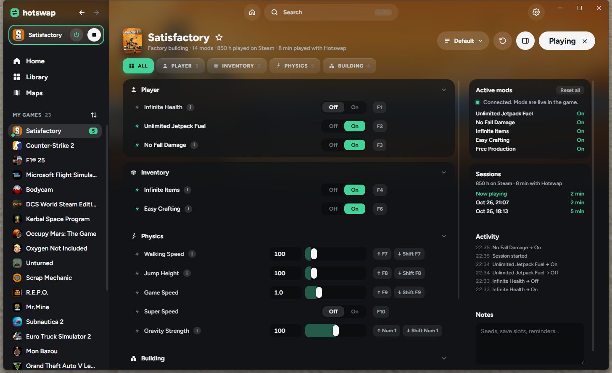
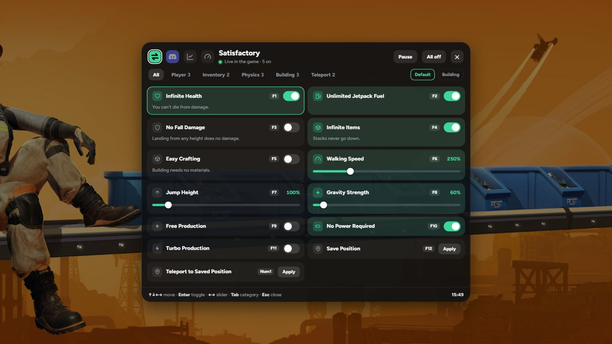
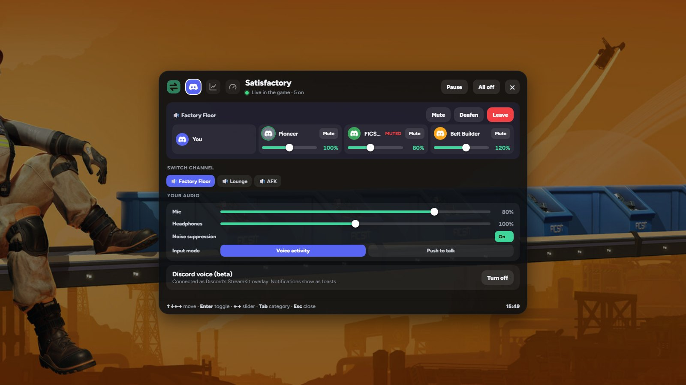
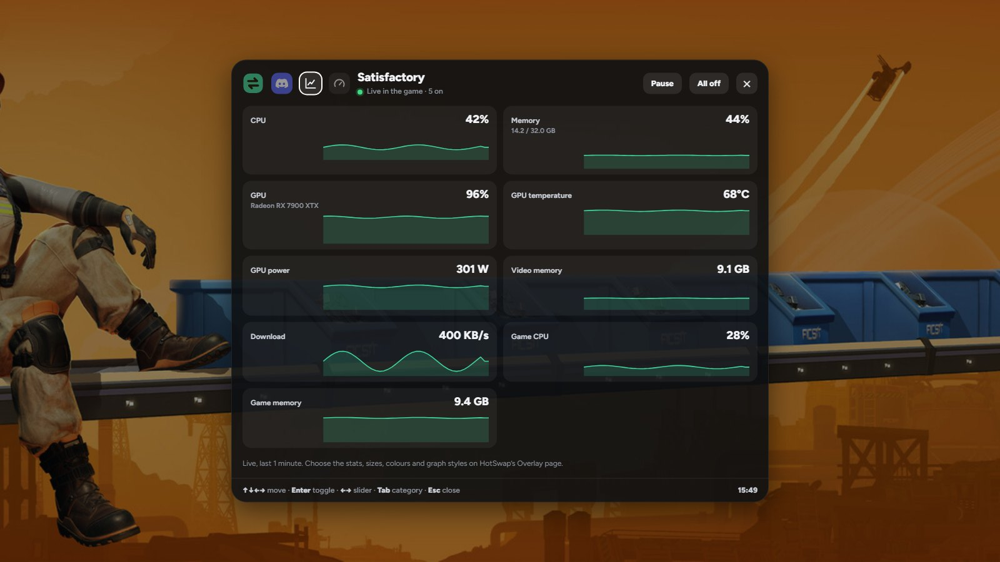
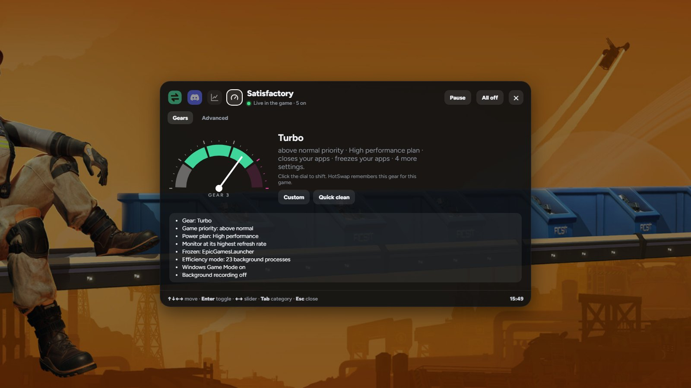
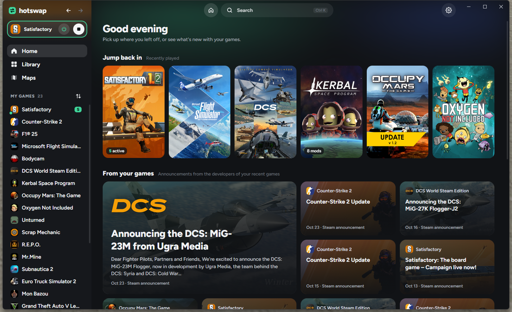
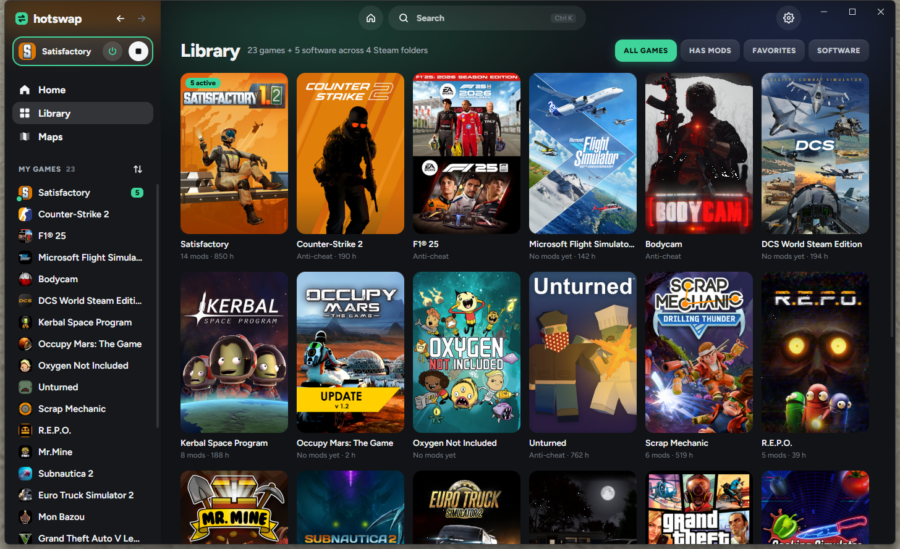

# 🔁 HotSwap

**Swap the way you play, in real time.**

HotSwap is a free, open-source, ad-free mod app for **single-player** PC games on Windows. Flip mods on and off while the game is running, from the app or with hotkeys that work inside the game.

> 💡 **Inspired by ArtCraft.**
> 🤖 **Made by AI.** HotSwap was designed and written by Claude (Anthropic's AI) in Claude Code, directed by [@Zetenypapp](https://github.com/Zetenypapp).

> 📖 **Every game, mod and feature in detail: [FEATURES.md](FEATURES.md)**



## 🎮 Games

- **Live mods:** Satisfactory, Subnautica, Subnautica: Below Zero, Subnautica 2, R.E.P.O., Kerbal Space Program, Oxygen Not Included and Mon Bazou.
- **Experimental** (new, not tested in game yet): Euro Truck Simulator 2, American Truck Simulator, Stormworks, Unturned (singleplayer only), GTA V story mode and Mr.Mine.
- **Engine mods** for any single-player **Unity, Unreal, Godot, RPG Maker or Ren'Py** game, like Game Speed, Unlock FPS and Field of View.

Every other game still shows up in your library with art, playtime and launching. [See every game's mods →](FEATURES.md#-games)

## ✨ What's inside

- 🔁 **Live mods with hotkeys:** flip mods while you play, from the app or with keys that work in game, plus profiles and a panic key
- 🏎️ **Game Boost:** a gearbox for your PC while you play, from Eco to Redline, every gear yours to change ([details](FEATURES.md#️-game-boost))
- 🧩 **Mod loader:** install community mods from ficsit.app, Thunderstore, Nexus Mods and SpaceDock
- 🗺️ **Live maps** for Satisfactory and Subnautica, with your position and teleport
- 📚 **Your whole library** from Steam, Epic and GOG, with news, deals and playtime on Home
- 🛡️ **Safe by design:** no mods for anti-cheat games, signed updates, a locked-down app ([Security](#️-security))

## 🎛️ In-game overlay

Press **Insert** in a game for HotSwap's menu right over it:



- 🎮 **Mods:** every mod as a card, with profiles, pause and all off
- 💬 **Discord:** your voice call in game: who's talking, mute, deafen, volumes and channels
- 🏎️ **Game Boost:** shift gears on the rev-counter dial, Quick clean, and change any gear in Advanced
- 📊 **System stats:** live graphs of your CPU, GPU, memory, temperatures, disk, network and the game itself

| 💬 Discord | 📊 System stats | 🏎️ Game Boost |
|---|---|---|
|  |  |  |

Plus a small **HUD** in a corner, toasts when mods change, and a hotkey cheat sheet (hold Ctrl+F1). The overlay is a see-through window on top of the game, so nothing is injected; use **borderless or windowed** mode. [More about the overlay →](FEATURES.md#️-in-game-overlay)




## 🛠️ Built with

- 🦀 **Rust + [Tauri 2](https://tauri.app):** library scanning, game detection, hotkeys, launching, and the memory engine
- 🌐 **Plain HTML, CSS and JavaScript** for the interface (no framework, no build step)

## 🚀 Run it

Needs Windows, [Rust](https://rustup.rs), and the Visual Studio C++ build tools.

```sh
cd src-tauri
cargo run
```

Dev helpers: `hotswap.exe --scan` prints your detected library, `--home` prints the live Home data, `--trainer-peek` and `--machine-peek` inspect a running Satisfactory.

## 🔧 Modifying HotSwap

Want to change something? **[ARCHITECTURE.md](ARCHITECTURE.md)** lists every file with a one-line description of what it does. The short version:

**Safe to change:**
- 🎨 **Looks and text:** `ui/styles.css`, the page files in `ui/` and the overlay in `ui/overlay.html`. The worst case is a page that looks wrong; reload it with Ctrl+R in the app (it's a web page).
- 📋 **Mod names, descriptions and default hotkeys:** `ui/data.js`. A mod only shows as working when its ID is in that game's `LIVE` list, and the ID must match the one its game file uses.

**Change with care:**
- 🎮 **Game support** (`ksp.rs`, `sn1.rs`, `sn2.rs`, `repo.rs`, `extra.rs`, `mono.rs`, `ue/`): these write into a running game's memory. A wrong class, field or value can crash the game or put a bad value into your save, so test on a throwaway save and keep backups. Game updates can rename things; HotSwap looks classes and fields up by name, so a renamed one just stops that mod rather than breaking the game.
- 🧩 **Mod installers** (`modloader.rs`, `modfiles.rs`, `thunderstore.rs`, `spacedock.rs`): these add and delete files in your game folders. A mistake can remove mod files or leave a game that won't start until you verify its files in Steam.
- ⌨️ **New engine commands:** a new `#[tauri::command]` has to be added in three places, or the interface's call is silently refused: the `generate_handler!` list in `main.rs`, `src-tauri/build.rs`, and `src-tauri/capabilities/default.json`.

**Don't:**
- 🛡️ Add mods for games with anti-cheat, or for multiplayer advantages. HotSwap is single-player only and deliberately refuses games with VAC, Easy Anti-Cheat, BattlEye and similar; that check lives in the library code and must stay.
- 🔑 Ship builds signed with your own updater key under the HotSwap name: installed copies only accept updates signed with the project's key.

## ⚠️ Fair play

HotSwap is for **single-player and private games only**. It refuses to mod anything with anti-cheat, and you shouldn't use it to get an edge over other players.

## 🛡️ Security

HotSwap changes other programs' memory, so it's built to be careful with its own:

- **Locked-down app window.** A strict Content Security Policy: only HotSwap's own script files run. No inline code, no `eval`, no plugins, and the app can only talk to itself and GitHub's API. Even if a mod description or news item contained malicious code, it couldn't run.
- **Least privilege for every window.** The in-game overlay can only use the 9 commands it needs, the enemy radar only receives positions, and the map website only gets the map commands. Neither can launch games, write files or install mods.
- **Signed updates.** Every update is checked against HotSwap's signing key before it installs.
- **Safe downloads.** Mod archives come over HTTPS, have size limits, and are unpacked with a zip library that refuses paths escaping the target folder (kept up to date for known zip security issues).
- **Local only.** The game connections (Stormworks addon, Ren'Py, Godot and GTA scripts, web games' debug port) only listen on `127.0.0.1`, so nothing on your network can reach them, and the scripts only accept answers from HotSwap's own port.
- **Anti-cheat aware.** Games with anti-cheat get no mods. The few exceptions (Unturned singleplayer, GTA V story mode) turn themselves off the moment you go online, and HotSwap stops touching a game for good if its anti-cheat loads.
- **Logged, not silent.** Anything the security policy blocks is written to HotSwap's logs (Settings → Export logs).
- **Scanned.** Every release is checked with Microsoft Defender before it's published.

## 🔒 Privacy

HotSwap doesn't send anything about you anywhere. It only talks to the services you use through it (Steam, Thunderstore, SpaceDock, ficsit.app, Nexus Mods, GitHub for updates, and Discord on your own PC), and only to fetch what you ask for.

## ⚖️ License

HotSwap is free software under the [GNU General Public License v3.0 or later](LICENSE). You can use, change and share it, and sell copies, as long as what you share stays under the same license with its full source code and keeps the copyright notice.

The **HotSwap** name and logo aren't covered by the license: forks need their own name and logo, so nobody mistakes them for HotSwap.

Copyright © 2026 Zetenypapp

## 📜 Credits

- Euro Truck Simulator 2 and American Truck Simulator mods: ported from [ETS2Trainer](https://github.com/Despical/ETS2Trainer) by Berke Akçen (Despical), GPL-3.0
- Font: [Figtree](https://github.com/erikdkennedy/figtree), SIL Open Font License
- Game news and store data: Steam Web API and storefront; deals: [CheapShark](https://www.cheapshark.com)
- Game artwork is read from your own Steam install and is never bundled or redistributed


Want to join the discord? https://discord.gg/DadXW3q9Jp
